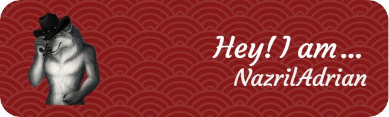

  

  <h1>Hi, I'm Nazril Adrian 👋</h1>
  
<strong>Developer • Lifelong learner • Football enthusiast</strong>

  

    
    
  

## About me

- 🔭 Currently working at **PT Cinta Sejati**
- 🌱 Currently learning **Go** and **JavaScript**
- 💡 Interested in building useful, clean, and reliable software
- ⚽ Football fan: **Real Madrid**, **Juventus**, and **Manchester United**
- 📍 Based in Indonesia

## Tech stack

  

## GitHub activity

  
  

  

## Let's connect

  

  

  Thanks for visiting my profile! ⭐

